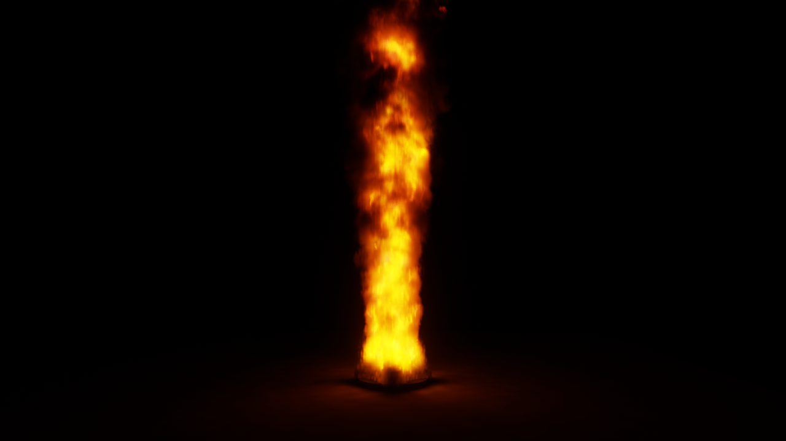
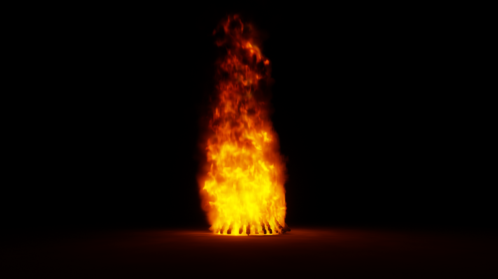

# pyro：离线大规模火焰燃烧模拟与渲染

**Offline GPU fire simulation and physically based rendering in Rust + wgpu.** Fuel pyrolysis (solids and liquid pools), low-Mach turbulent combustion with soot formation/oxidation, a multigrid pressure solver, and a volume renderer that integrates soot blackbody emission over the CIE colour-matching functions in real photometric units. Outputs PNG frames and an mp4. No Blender/Houdini needed — only ffmpeg for encoding.

Rust + wgpu（Metal / Vulkan）写的原生程序：GPU 上做可燃物热解 + 低马赫数湍流燃烧模拟，再用体积渲染器按物理单位成像，输出 PNG 帧和 mp4。不依赖 Blender/Houdini，只需要 ffmpeg（编码视频）。



*1 m 正庚烷油池火，2 cm 网格（820 万单元），720p。*



*直径 6 m 的原木大篝火（`scenes/bonfire.toml`），10 cm 网格（610 万单元），22 m 外仰拍。*

## 安装

需要 Rust（1.85+）、ffmpeg（可选，用于合成视频），以及下列任一 GPU 后端（wgpu 自动选择，着色器为 WGSL，会自动翻译）：

| 系统 | 后端 |
|---|---|
| macOS | Metal |
| Windows | DirectX 12 / Vulkan |
| Linux | Vulkan |

可用环境变量强制指定，如 `WGPU_BACKEND=vulkan`。开发和验证在 Apple M5（Metal）上完成；Linux/Windows 由 CI 保证能编译与通过单元测试，GPU 上的实际运行尚未在这两个平台测试。显存/内存建议 8 GB 以上（2 cm 网格约需 3 GB）。

```
cargo build --release
./target/release/pyro scenes/pool.toml --still 9 --open
```

## 用法

```
pyro scenes/pool.toml                    # 按场景文件渲染视频（输出到 renders/pool/）
pyro scenes/pool.toml --cell 0.02        # 覆盖网格尺寸（越小越细、越慢）
pyro scenes/pool.toml --still 9          # 只出第 9 秒一张静帧
pyro scenes/pool.toml --sim-only         # 只模拟，打印统计量与实验对照
pyro scenes/pool.toml --sim-only --slice # 另输出中心截面（T、燃料、氧、碳烟、放热率）
```

其它参数：`--spp` 每像素采样、`--res 1920x1080`、`--preroll` 预热秒数、`--duration`、`--ev` 曝光补偿、`--out`、`--open`。

## 场景文件

TOML，见 `scenes/`。物体类型：`box`、`cylinder`、`sphere`、`pool`（液池）、`crib`（木垛）、`pallets`（托盘堆）、`bonfire`（圆锥原木大篝火）。
材料：`wood`、`cardboard`、`pu_foam`、`pmma`、`rubber`、`heptane`、`gasoline`、`diesel`（可燃），`steel`、`concrete`（不燃）。

## 物理模型

- **流体**：交错网格（MAC），MacCormack 平流（RK2 回溯 + 极值限制），低马赫数可压缩修正（∇·u = 放热膨胀 + 热解气注入），4 层几何多重网格 V-cycle 压力求解，涡量约束，Smagorinsky 亚格子扩散。
- **燃烧**：单步总包反应，涡耗散速率，混合时间按 FDS 取 min(τ_u, τ_g)（τ_u 用 Deardorff 亚格子动能），点火温度门限；温度相关比热。
- **碳烟**：富燃区随燃烧生成、高温富氧区氧化，没烧完的成为黑烟；未燃热解气冷凝成白色气溶胶。
- **固体/液体**：表面能量平衡（多射线辐射反馈 + 对流 + 导热 + 点火热流），Tewarson 气化热模型；木材成炭、炭氧化发红；液池在沸点前 60 K 开始蒸发。
- **辐射损失**：光学薄 × 逃逸因子（大火焰自吸收修正）。

## 渲染

- 模拟场打包成 3D 纹理（碳烟体积分数、温度、白烟、放热率），8³ 砖块跳过空区域。
- **颜色**：用 CIE 1931 配色函数对普朗克谱积分，碳烟按 Rayleigh 吸收 κ_λ ∝ f_v/λ 发射，单位 cd/m²；火焰根部加 CH*/C₂* 化学发光的蓝色。
- **火光照明**：每帧按发光功率 × 逃逸率建立逐单元重要性分布，用阴影射线计算烟雾（半分辨率体缓存，记录通量与平均入射方向，按 Henyey–Greenstein 相函数近似前向散射）与地面（2D 照度缓存）的照明，再做可分离高斯去噪。也可切换为纯路径追踪（`mode = "path"`，NEE + 相函数采样 + 幂启发式 MIS），用于对照。
- **相机**：像素抖动抗锯齿、按速度场的运动模糊（快门角）、薄透镜景深、自动曝光（随时间平滑）、三尺度镜头眩光、ACES 色调曲线。

## 验证（1 m 正庚烷油池，4 cm 网格）

| 量 | 模拟 | 参考 |
|---|---|---|
| 单位面积燃烧速率 | 0.062 kg/m²s | 0.067（Babrauskas：0.101(1−e^{−1.1D})） |
| 热释放率 | 1.9 MW | ≈2.2 MW |
| 平均火焰高度（放热累计 50%） | 3.0 m | 3.8 m（Heskestad，按模拟 HRR） |

木托盘堆（12 个，5 cm 网格）：约 16 s 引燃，60 s 时 5.3 MW 仍在增长；Babrauskas 托盘堆公式峰值约 5.4 MW。

## 已知局限

- 辐射分数偏高（约 0.5，实验 0.3–0.4）：燃烧区改用 χr·q̇ 后液池热反馈失衡，暂保留光学薄模型。
- 压力求解相对残差 10⁻³–10⁻²；更精确需要多重网格预条件共轭梯度（MGPCG）。
- 稠密网格：2 cm 网格（820 万单元）每帧模拟约 3 s；更细需要稀疏网格。
- 还没有亚格子湍流细节放大（wavelet turbulence），火焰小尺度结构受网格限制。
- 固体不会坍塌、移动。
- 大火规模下（几十 MW）问题更明显：辐射分数可达 0.7–0.8；平流不严格守恒质量，热释放率比热解供给高约 50%。`bonfire.toml` 通过减少碳烟生成、加快氧化来获得合理外观。
